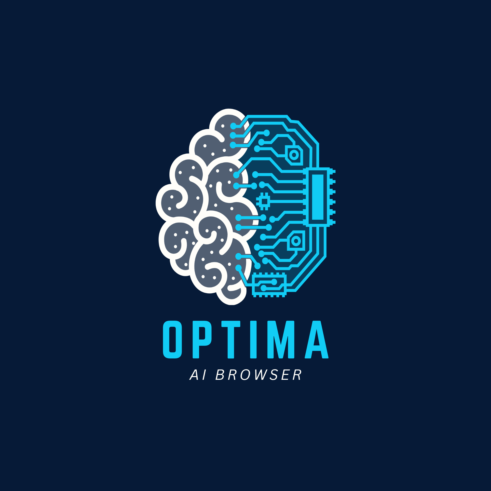

<p align="center">
  
</p>

<p align="center">
  <b>A browser built for AI assistants.</b><br>
  Clean pages for the agent, a quick tap for the human when it matters.
</p>

<p align="center">
  <a href="https://github.com/ascaniolocorotondo/optima-ai-browser/actions/workflows/test.yml"></a>
  <a href="https://glama.ai/mcp/servers/ascaniolocorotondo/optima-ai-browser"></a><br>
  macOS · Windows · Linux &nbsp;|&nbsp; MCP server + Claude skill &nbsp;|&nbsp; MIT
</p>

---

## Why Optima?

Ordinary browsers are made for human eyes. When an AI assistant drives one, it wastes time and
tokens on ads, pop-ups and cookie walls, loses its logins, and stalls without saying anything
the moment a site asks for a human.

Optima fixes the *agent* side of browsing, and keeps a person in the loop for the parts that
need one:

| | Ordinary browser + AI | Optima |
|---|---|---|
| What the agent sees | Raw HTML or screenshots | Clean text with numbered elements: `[12 button] Sign in` |
| Cookie banners | The agent clicks around them | Declined automatically ("reject" / "only necessary") |
| Logins | Lost between sessions | Persistent profile: log in once |
| CAPTCHA / "checking your browser" | Agent gets stuck | Detected → you get a notification → you solve it → the agent continues |
| Passwords & cards | Risky | Always typed by you; the agent is refused these fields |
| Buying, posting, deleting | Happens silently | Agent must ask you in chat first |
| What happened? | Unknown | Daily audit log |

> **Optima does not solve or bypass CAPTCHAs or bot protection, by design.** Those checks are
> how sites decide who gets in. Optima makes the hand-off to you take seconds instead.

## How it works

```
 AI assistant ──MCP──▶ Optima server (Python) ──▶ engine ──▶ the web
   (Claude…)            reading, rules,             macOS: native app on system WebKit
                        hand-off, log               Windows/Linux: Edge/Chrome via Playwright
                              │
                              └──▶ you: notification + "Your turn" banner + Done button
```

- **macOS:** a tiny native app (Swift + the WebKit that ships with macOS) that **you compile on
  your own Mac** during install. Nothing is downloaded, which helps on managed Macs where
  installing third-party apps is restricted.
- **Windows:** uses Microsoft Edge (already on every Windows PC) or Chrome through Playwright.
- **Linux:** uses Google Chrome if installed, otherwise downloads Playwright's Chromium once.

## Install

You need **Python 3.9+**. On macOS you also need the Swift compiler (Xcode or the Command Line
Tools: `xcode-select --install`).

### With pip (all systems)

```bash
pip install optima-ai-browser
optima setup
```

`optima setup` opens the first-run window (on macOS it compiles the native engine the first time).
On Windows and Linux, if Playwright has no browser yet: `python -m playwright install chromium`.

Or run the MCP server without installing anything permanently: `uvx optima-ai-browser mcp`.

### From source: macOS

```bash
git clone https://github.com/ascaniolocorotondo/optima-ai-browser.git
cd optima-ai-browser
sh install.sh
```

On macOS the installer also adds **Optima AI Browser** to `~/Applications`. Double-click it to
browse yourself, for example to log in to your sites: your assistant shares the same logins.

### From source: Linux

```bash
git clone https://github.com/ascaniolocorotondo/optima-ai-browser.git
cd optima-ai-browser
sh install.sh
```

If Chromium complains about missing libraries: `sudo ~/.optima/venv/bin/python -m playwright install-deps chromium`.

### From source: Windows (PowerShell)

```powershell
git clone https://github.com/ascaniolocorotondo/optima-ai-browser.git
cd optima-ai-browser
powershell -ExecutionPolicy Bypass -File install.ps1
```

> The installer copies Optima into `~/.optima`, so you can move or delete the cloned folder.
> To update, `git pull` and run the installer again.

## First run

The installer opens the Optima window:

1. **Choose your language.** English, Italiano, Español, Français, Deutsch or Português.
   Banners and notifications use it; the agent always gets English.
2. **Connect your assistants.** Optima detects **Claude Code**, the **Claude Desktop** app and
   **Google Antigravity**, installs its skill and registers its MCP server in each one you pick.
3. **Log in to your favourite sites** in that same window, so your assistant finds you signed in.

Prefer the terminal? `sh install.sh --cli` (or `install.ps1 --cli`).

Then restart your assistant and try: *"Use Optima to find the opening hours of the nearest
library."*

### Where Optima connects

| Assistant | Skill | MCP server |
|---|---|---|
| Claude Code | `~/.claude/skills/optima/` | user scope (`claude mcp add-json`) |
| Claude Desktop | upload `~/.optima/optima-skill.zip` in Settings → Capabilities → Skills | `claude_desktop_config.json` |
| Google Antigravity | `~/.gemini/config/skills/optima/` | `~/.gemini/config/mcp_config.json` |

### Connecting other MCP clients

Any MCP client can use Optima. If you installed it with pip:

```json
{ "command": "optima", "args": ["mcp"] }
```

From source, use the launcher (no environment variables needed):

```json
{
  "command": "/path/to/python",
  "args": ["~/.optima/app/src/optima_launcher.py", "mcp"]
}
```

On macOS `/path/to/python` is your `python3`; on Windows and Linux it is the one in
`~/.optima/venv`. Copy `src/optima/skill/` into your assistant's skills folder if it supports
[Agent Skills](https://agentskills.io).

## Tools for the agent

| Tool | What it does |
|---|---|
| `browser_open(url)` | Open a page, return it as clean text |
| `browser_read(max_chars?)` | Read the current page again |
| `browser_click(id, confirmed?)` | Click an element by its number |
| `browser_type(id, text, submit?, confirmed?)` | Type into a field (never passwords or cards) |
| `browser_select(id, value)` | Pick an option in a drop-down |
| `browser_scroll(direction)` | `down`, `up`, `top`, `bottom` |
| `browser_navigate(action)` | `back`, `forward`, `reload` |
| `browser_screenshot()` | PNG of the page, when visuals matter |
| `browser_ask_human(reason)` | Hand control to you and wait for **Done** |
| `browser_wait(seconds)` | Wait for slow pages |
| `browser_recent_actions(limit?)` | Today's audit log |

The bundled **skill** (`src/optima/skill/SKILL.md`) only applies where Optima is turned on: if the
`browser_*` tools are not available in a chat (for example you disabled the `optima` MCP server
there), the assistant ignores the skill and uses its usual browser without mentioning Optima.
Where Optima is on, it teaches the assistant when to use Optima (APIs and
connectors first), how to act by element id, when to call you, and to always confirm purchases,
messages and deletions with you.

## Configuration

`~/.optima/config.json` (created on first run):

| Key | Default | Meaning |
|---|---|---|
| `language` | chosen on first run | `en`, `it`, `es`, `fr`, `de`, `pt` |
| `engine` | `auto` | `webkit` (macOS), `playwright` |
| `playwright_channel` | `auto` | `chrome`, `msedge`, `chromium` |
| `headless` | `false` | Hide the window (Playwright only; hand-offs need a window) |
| `identify_as_agent` | `true` | Adds `Optima/<version> (AI agent; +repo)` to the user agent |
| `dismiss_cookie_banners` | `true` | Always the privacy-preserving choice |
| `auto_handoff` | `true` | Call you automatically when a human check appears |
| `handoff_timeout_seconds` | `300` | How long to wait for you |
| `min_action_interval_ms` | `400` | Gentle pace between actions |
| `notify_desktop` | `true` | System notification on hand-off |
| `ntfy_topic` | `""` | Optional phone push via [ntfy](https://ntfy.sh): set a private topic name and subscribe to it in the ntfy app |
| `policies.confirm_before` | `["purchase","send","delete"]` | Actions the agent must confirm with you |
| `policies.block` | `[]` | Actions never allowed (same categories, plus `submit`) |
| `policies.human_only_fields` | `true` | Password and payment fields are yours only |

Data lives in `~/.optima/`: `config.json`, `logs/` (one JSON-lines file per day) and, for
Playwright, `profile/`. The macOS engine keeps cookies in the system WebKit store for the app.

## Commands

```bash
python3 -m optima setup            # first-run window again (add --cli for terminal)
python3 -m optima open example.com # open Optima yourself, e.g. to log in
python3 -m optima doctor           # check the installation
python3 -m optima mcp              # the MCP server (started by assistants)
```

Run them with `PYTHONPATH=~/.optima/app/src` (or from the repo's `src` folder).

## Principles

- **Humans decide.** CAPTCHAs, logins, passwords, payments and one-time codes are always done by you.
- **Honest.** Optima identifies itself as an AI agent and paces its requests.
- **Private.** No telemetry. Cookie banners get "reject". Nothing leaves your machine except the
  pages you visit and, if you set one, your ntfy notification.
- **Accountable.** Every action is logged locally.

## Roadmap

- [Web Bot Auth](https://datatracker.ietf.org/wg/webbotauth/about/) signed requests, so sites that welcome verified agents can let Optima in without a check
- Multiple tabs and downloads
- Per-site rules (e.g. read-only on banking sites)
- Packaged releases

## Contributing

Issues and pull requests are welcome. Keep the principles above: features that help an agent
evade CAPTCHAs, fingerprinting or bot detection won't be merged.

## How it was made

Optima was designed by [@ascaniolocorotondo](https://github.com/ascaniolocorotondo) and written
largely with the help of [Claude](https://claude.com) (Anthropic's AI assistant), then tested on
macOS, Windows and Linux in CI.

## License

[MIT](LICENSE)

<!-- mcp-name: io.github.ascaniolocorotondo/optima-ai-browser -->
